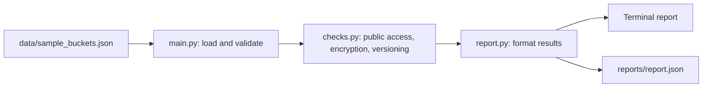

# CloudSentinel: AWS S3 Storage Security Checker

A beginner-friendly Python tool that analyses S3 bucket configuration data, flags potential security issues, assigns risk levels and recommends fixes.

> **Status:** This version analyses **sample JSON data** that mimics S3 settings. It is **not connected to AWS** and has **not been deployed**. Optional read-only AWS integration is listed under Future Improvements.

## Problem Statement

Misconfigured cloud storage is a common cause of data exposure. Settings such as public access, encryption and versioning are easy to get wrong and hard to review by hand across many buckets. CloudSentinel automates a basic review and explains what to fix.

## Features

- Checks **public access block** settings (all four switches)
- Checks **default encryption** (SSE-S3 / SSE-KMS)
- Checks **versioning** status (Enabled / Suspended / Disabled)
- Results labelled **PASS**, **WARNING** or **NEEDS ATTENTION**, with a **risk level** (LOW / MEDIUM / HIGH) and a **recommendation**
- Readable **terminal report**, sorted with the most serious findings first
- Machine-readable **JSON report**
- Clear **error handling** for missing files, invalid JSON and wrong data shapes
- **19 automated tests** with pytest

## Technology Stack

- Python 3.12
- Standard library only (`json`, `argparse`, `os`, `datetime`)
- pytest (testing)
- Git and GitHub

## Architecture



## Installation

```bash
git clone https://github.com/jeffersonakash-72/cloudsentinel-s3-security-checker.git
cd cloudsentinel-s3-security-checker
python3 -m venv .venv
source .venv/bin/activate
pip install pytest
```

## Usage

```bash
python3 -m cloudsentinel.main
```

Options:

```bash
python3 -m cloudsentinel.main --input data/sample_buckets.json --output reports/report.json
```

## Example Result

Summary for the four sample buckets:

| Status | Count |
|---|---|
| PASS | 6 |
| WARNING | 4 |
| NEEDS ATTENTION | 2 |

Example finding:

```
[NEEDS ATTENTION] Encryption  (risk: HIGH)
    Default encryption is not enabled.
    Fix: Enable default encryption (SSE-S3 or SSE-KMS) on the bucket.
```

## Running the Tests

```bash
python3 -m pytest -v
```

## Risk Logic

| Finding | Status | Risk |
|---|---|---|
| All four public access protections off, or encryption off | NEEDS ATTENTION | HIGH |
| Some public access protections off, versioning disabled or suspended, unknown encryption algorithm | WARNING | MEDIUM |
| Setting configured correctly | PASS | LOW |

## Security Considerations

- Uses **only fictional sample data**. No real bucket names, account IDs or credentials are included.
- `.gitignore` excludes `.env`, key files, AWS credential files and generated reports.
- Never commit AWS access keys. If AWS integration is added, use read-only permissions and credentials stored outside the repository.

## Limitations

- Analyses **sample data only**, not a live AWS account.
- Checks only three settings. It does not inspect bucket policies, ACLs, logging, lifecycle rules or object-level permissions.
- Risk levels are simple rules, not a full risk-scoring model.
- This is a learning project, not a replacement for AWS Config, AWS Security Hub or similar tools.

## Future Improvements

*These are not implemented.*

- Read-only AWS S3 integration with boto3 and least-privilege IAM permissions
- Additional checks (bucket policies, access logging, MFA delete)
- AWS Lambda for scheduled scans and Amazon CloudWatch for alerts
- GitHub Actions to run tests automatically

## Author

Akash Jefferson V